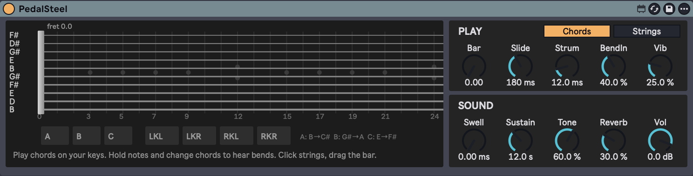
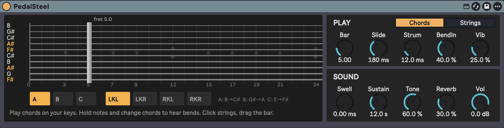
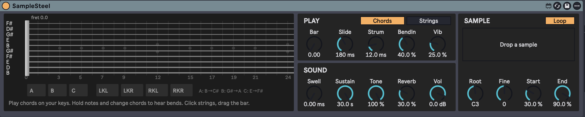
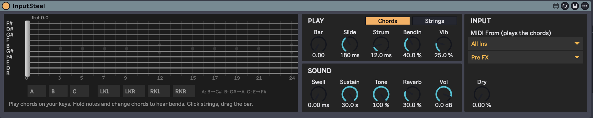

# Pedal Steel (Max for Live instrument)

A 10-string E9 pedal steel guitar for Ableton Live that you can play without ever having touched one.
Play chords on a keyboard; it voices them like a steel player would: one bar position plus pedals
and knee levers. Change chords legato and the strings **bend** (pedals) or **slide** (bar) into the new chord.



Listen: `docs/demo.wav` (E major → legato A major pedal bend → slide up to C), rendered from the actual engine code.

## Install
Copy everything in `m4l/` into one folder (e.g. your User Library) and drag `PedalSteel.amxd` onto a MIDI track.
The `.js` files must stay next to the `.amxd`.

## Playing
| | Chords mode (default) | Strings mode (the real instrument) |
|---|---|---|
| Keys | Any notes/chords. Out-of-range notes fold into the steel's range | White keys C3–E4 pick strings 10→1 |
| Pedals | Chosen automatically; click one on the display to latch it | White keys C2–B2 hold A, B, C, LKL, LKR, RKL, RKR |
| Bar | Moves by itself; the Bar knob / dragging the neck slides it | Bar knob / drag the neck |
| Legato | Hold notes into the next chord → bends and slides | — |

In both modes: pitch bend slides the bar ±2 frets, mod wheel adds vibrato, CC 64 sustains, and CC 11 is the volume pedal.

**MPE** (Push 3, Seaboard, Linnstrument…): each note's own pitch bend bends just its string(s) (±48 semitones,
the MPE default), pressure swells that string's level, and slide (CC 74) makes it darker or brighter.
Channel 1 stays global, so ordinary keyboards play exactly as before.
Click any string on the display to pick it.

On Push the encoders page through **Play** (Bar, Slide, Strum, Bend In, Vibrato, Mode), **Sound**, and **Pedals**
(each pedal and knee lever shows Off/On; turn one to latch it). SampleSteel adds a **Sample** page.

Knobs: **Bar, Slide** (glide time), **Strum**, **Bend In** (how often chords are picked unpedaled then bent up: the steel "cry"),
**Vibrato**, **Swell** (volume-pedal fade-in per note), **Sustain, Tone, Reverb, Volume**. Every control has Info View help.

Pedal board: **outlined** = pressed by the voicing for this chord, **solid** = latched by you,
**solid with a white border** = latched and this chord uses it.



## How it sounds like a steel
A pedal steel's sound is half the instrument and half the player. Most of what makes it recognisable is
*pitch that moves while a string keeps ringing*: pedals bending notes into a chord, the bar sliding into
the next one. So the device has two parts. `steel_brain.js` plays like a steel player, and the gen~ engine
behaves like strings that can be re-tuned while they ring.

### The player (`m4l/steel_brain.js`)
- **Real E9 tuning and real pedals.** Ten strings (F#4 D#4 G#4 E4 B3 G#3 F#3 E3 D3 B2) with the standard
  A/B/C pedals and four knee levers, each raising or lowering the same strings as on a standard E9 setup.
- **Voicing like a player.** Every chord is scored across all 23 bar positions (nut to fret 22) × 96 pedal combinations a
  player can physically press (any of A/B/C, one left-knee lever, RKL, RKR). The score prefers the melody
  on top, compact string groups, few pedals, small bar moves, and above all *keeping ringing strings ringing*.
  Notes no grip covers are bent behind the bar on a spare string, the way players do.
- **Legato = bends and slides, not re-picks.** Held strings that belong to the next chord glide to their new
  pitch: pedal changes take 60–400 ms (0.6 × Slide), bar moves take the Slide time. Strings that had already
  faded (held longer than a third of the Sustain time, about 20 dB down) are picked again as they slide, so a change is never silent.
- **The "cry" (Bend In).** On a fresh chord that needs raise pedals, sometimes the strings are picked
  *unpedaled* and the pedals are pressed ~90 ms after the strum: the signature pedal steel swoop into a chord.
  Bend In also makes raise pedals cheaper in the scoring, so the player reaches for them more.
- **Cabinet drop.** Each raise pedal or lever that's down flattens the strings it doesn't pull by 1 cent,
  like a real cabinet flexing under the extra tension (`CAB_DROP` in `steel_brain.js`).
- **Strum and pick order.** Chords are picked low string to high with the Strum spacing, like a thumb and
  fingerpicks rolling through a grip.

### The instrument (gen~ engine, generated by `scripts/build_maxpat.py`)
- **Ten Karplus-Strong waveguides.** Each string is a delay line one period long with a one-pole loss filter
  in the loop. The loop's delay is read with cubic interpolation, and the filter's phase delay is subtracted,
  so every string stays within ±1 cent of its target at any pitch (checked by `tests/test_engine.js`).
- **Pitch that glides while ringing.** The delay length follows a pitch ramp that runs linearly in semitones
  over the glide time. Because the ringing waveform is re-read at a new rate rather than restarted, a pedal
  or bar move sounds like the same string being stretched, not a new note. Strings about to be picked jump
  straight to pitch; ringing ones glide.
- **The pick.** A string plucked a fixed distance from the bridge (`PICK_FRAC`) gives a two-level wave, so harmonics
  with a node at the pick point drop out, with a little noise for pick scratch. It is low-passed harder for soft notes
  and lighter for hard ones (and by Tone), so velocity changes brightness as well as level. The wave is level-matched
  so every pitch is picked equally hard, and each pick goes up or down at random so a chord's strings don't all
  push the same way at once.
- **The pickup.** A single coil sits a fixed distance from the bridge (`PICKUP_FRAC`), so it hears each string
  and its bridge reflection a fixed time apart, which comb-filters every string at fixed frequencies. The coil's
  resonant low-pass (`PICKUP_RES_HZ`) adds the bite of a real pickup. The sympathetic bus still taps the strings
  before the pickup, so the strings still couple at the bridge.
- **Long sustain, fast damping.** A per-pass gain makes each string ring down 60 dB over the Sustain time
  (up to 30 s, steel strings barely die); a released string decays in 150 ms and darkens, like a palm block.
- **Slight detune.** Each string is ±0.5–1.5 cents off, so chords shimmer instead of beating perfectly
  in unison like a synth.
- **Bar vibrato.** A 5.5 Hz, up to ±0.3 semitone vibrato that restarts at zero on each pick and fades in over
  0.7 s, like a player who picks, then starts shaking the bar. It moves the pitch of every string together,
  because it's one bar.
- **Volume-pedal swell.** Per-note fade-in with a squared (audio-taper) curve, and CC 11 as a global
  volume pedal, for the "no attack" steel swell.
- **Sympathetic resonance.** A shared bus carries the (DC-blocked, lowpassed) average of every other
  string's previous sample into each string's delay line, so ringing strings excite open ones that share
  pitches or partials, the way a real steel's strings couple through the bridge. Released strings are blocked
  for 0.4 s and then open again, and lifting the last key palm-blocks every string, so the ring stops with
  the phrase.
- **Amp and spring reverb.** Strings are panned across the stereo field (low strings left, high strings
  right), summed into a gentle `tanh` stage that stays clean except on big strums, then a spring-tank reverb
  (a modulated, band-limited feedback loop through a short allpass dispersion chain per side, L/R
  decorrelated) for the amp's metallic "boing", a DC blocker and a soft limiter.

## SampleSteel: any sound as a pedal steel
`m4l/SampleSteel.amxd` is the same instrument (brain, neck, pedals, bar, legato bends and slides, every
PLAY knob) with the ten strings replaced by ten voices playing a sample you drop in. Drop a bowed violin
and you get a violin that bends and slides like a steel.



The SAMPLE card draws the dropped sample's waveform; the lit section is the loop (**Start**–**End**).
The screenshot uses `docs/sample.wav`, a synthetic bowed-style tone at C3.

1. Drag `SampleSteel.amxd` onto a MIDI track (it needs the two `.js` files next to it, like PedalSteel).
2. Drop an audio file on **Drop a sample** (from Live's browser or Finder). A single held note works best.
3. Set **Root** to the note the sample was recorded at (and **Fine** if it sits between notes), then play.

| Control | What it does |
|---|---|
| **Loop** | On (default): held notes loop the **Start**–**End** section (% of the sample) with a 50 ms equal-power crossfade, so they sustain and bend as long as you hold them. Off: the sample plays once, for plucked or struck sounds. |
| **Root / Fine** | The sample's pitch. Every voice plays `sample speed = note frequency / Root frequency`, so bends and slides bend the recording. |
| **Sustain** | How long a held note fades; fully up (the default) never fades. |
| **Tone** | A low-pass filter, fully open by default. |
| Swell, Reverb, Volume | As in PedalSteel (same spring reverb and amp). |

The dropped file's path is saved with the Live set and reloads with it. Stereo files play their left channel.
The brain drives both devices the same way, so every improvement to `steel_brain.js` reaches both.

## InputSteel: your instrument as a pedal steel
`m4l/InputSteel.amxd` is an **audio effect**: the same brain, neck, pedals and PLAY knobs, but the ten voices
are the audio coming into the track, each pitch-shifted to its string's note. Sing, play a sax or a guitar
note, hold chords on a keyboard, and your sound bends and slides into them like a steel.



1. Drop `InputSteel.amxd` on the track with your instrument (the `.js` files next to it, as for PedalSteel).
2. Make a MIDI track for the chords and pick it in **MIDI From** on the device (second menu: which tap).
   Set that MIDI track's Monitor to In (or arm it) so your keyboard reaches it.
3. Play a note into the input and hold chords.

The input's pitch is tracked (Max's `fzero~`), so each voice shifts by *string note ÷ input pitch*: any
note you play becomes the chord. Tracking wants **one note at a time**; chords or noise into the input
give wobbly pitch. Each voice is a two-tap delay-line pitch shifter whose window is two input periods,
so the taps stay in phase and slides don't click. **Dry** mixes the untouched input back in; Sustain
fully up (the default) lets held notes last as long as the input does.

## Build
```bash
./build.sh
```
This runs the tests, generates `m4l/PedalSteel.maxpat`, `m4l/SampleSteel.maxpat` and `m4l/InputSteel.maxpat` from `scripts/build_maxpat.py` / `build_sampler.py` / `build_input.py` (the source of truth; never hand-edit
the `.maxpat`/`.amxd`), syntax-checks the gen~ code against Cycling '74's GenExpr grammar, validates them, and packs the `.amxd` files.
Uses `../MaxForLiveTools/build_amxd.py` and `../NAMMaxInstrument_CombinedOnly/scripts/validate_maxpat.py`.

| File | What |
|---|---|
| `m4l/steel_brain.js` | MIDI → voicing solver (bar fret × pedal combos), legato bends/slides, Strings mode |
| `m4l/steel_neck.js` | jsui: neck, bar, pedal board; mouse picking, bar drag, and momentary pedals |
| `scripts/build_maxpat.py` | Patch + gen~ engine (10 Karplus-Strong strings with gliding pitch, swell, bar vibrato, amp, reverb) |
| `scripts/build_sampler.py` | SampleSteel: the same patch via `build_maxpat.build()`, with 10 looping sample voices and the SAMPLE card |
| `tests/test_engine.js` | Runs the generated gen~ code in Node: tuning (±1 cent), glides, headroom, damping, swell |
| `scripts/build_input.py` | InputSteel: the same patch as an audio effect, 10 pitch-shifted voices of the input, fzero~ tracking, MIDI From |
| `tests/test_input.js` | Runs InputSteel's gen~ code with a synthetic input: tuning, input-pitch following, glides, steady sustain, release, Dry, headroom |
| `tests/test_sampler.js` | Runs SampleSteel's gen~ code with a synthetic sample: tuning, glides, looping, click-free loop seam, one-shot, release |
| `tests/gen_shim.js` | The GenExpr → JS shim both engine tests share |
